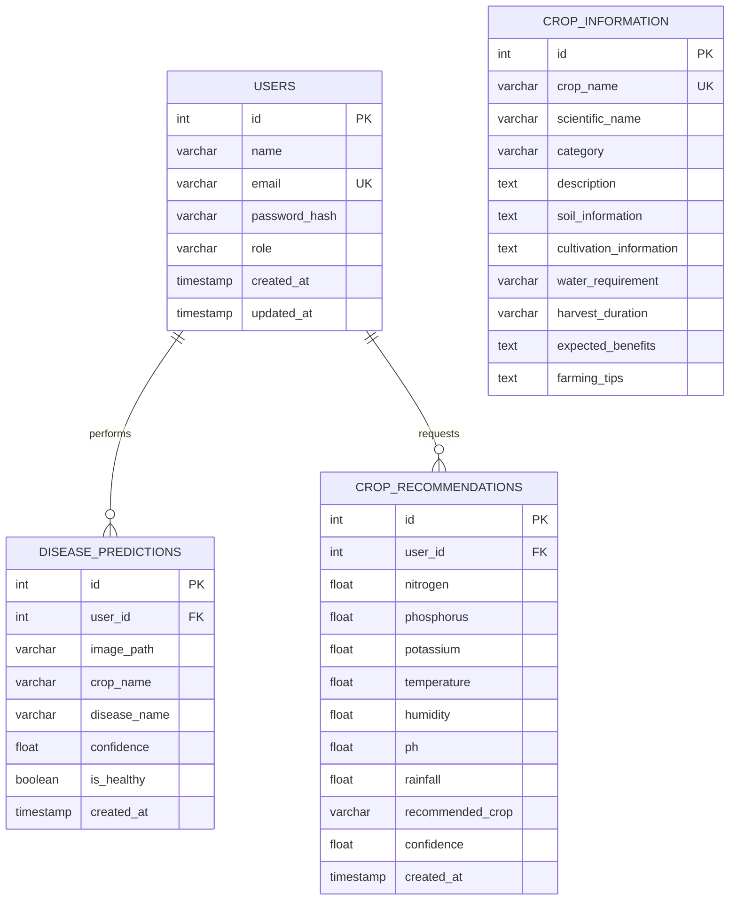

# Database Design & Entity-Relationship Documentation

## 1. Relational Entity Relationship (ER) Model

---

## 2. Table Specifications & Data Dictionaries

### 2.1 Table: `users`
Stores user credentials and identity profiles. Passwords are encrypted before insertion.

| Column | Type | Constraints | Description |
| :--- | :--- | :--- | :--- |
| `id` | INT | AUTO_INCREMENT, PRIMARY KEY | Unique user identifier |
| `name` | VARCHAR(100) | NOT NULL | Full name of the user |
| `email` | VARCHAR(120) | NOT NULL, UNIQUE, INDEX | User login email address |
| `password_hash` | VARCHAR(255) | NOT NULL | Salted cryptographic password hash |
| `role` | VARCHAR(20) | DEFAULT 'farmer' | User authorization role |
| `created_at` | TIMESTAMP | DEFAULT CURRENT_TIMESTAMP | Account creation timestamp |
| `updated_at` | TIMESTAMP | ON UPDATE CURRENT_TIMESTAMP | Last profile modification |

### 2.2 Table: `disease_predictions`
Records every leaf diagnosis made by registered users.

| Column | Type | Constraints | Description |
| :--- | :--- | :--- | :--- |
| `id` | INT | AUTO_INCREMENT, PRIMARY KEY | Unique prediction record ID |
| `user_id` | INT | NOT NULL, FOREIGN KEY -> `users(id)` ON DELETE CASCADE | Associated user ID |
| `image_path` | VARCHAR(255) | NOT NULL | Relative path to uploaded leaf image |
| `crop_name` | VARCHAR(100) | NOT NULL, INDEX | Identified host crop |
| `disease_name` | VARCHAR(150) | NOT NULL | Diagnosed disease/condition |
| `confidence` | FLOAT | NOT NULL | Prediction confidence percentage |
| `is_healthy` | BOOLEAN | DEFAULT FALSE | Boolean flag if plant is healthy |
| `created_at` | TIMESTAMP | DEFAULT CURRENT_TIMESTAMP, INDEX | Timestamp of diagnosis |

### 2.3 Table: `crop_recommendations`
Stores soil and weather parameter inputs along with the ML recommended crop.

| Column | Type | Constraints | Description |
| :--- | :--- | :--- | :--- |
| `id` | INT | AUTO_INCREMENT, PRIMARY KEY | Unique recommendation record ID |
| `user_id` | INT | NOT NULL, FOREIGN KEY -> `users(id)` ON DELETE CASCADE | Associated user ID |
| `nitrogen` | FLOAT | NOT NULL | Nitrogen content (N) ratio |
| `phosphorus` | FLOAT | NOT NULL | Phosphorus content (P) ratio |
| `potassium` | FLOAT | NOT NULL | Potassium content (K) ratio |
| `temperature` | FLOAT | NOT NULL | Ambient temperature (°C) |
| `humidity` | FLOAT | NOT NULL | Relative humidity (%) |
| `ph` | FLOAT | NOT NULL | Soil pH value |
| `rainfall` | FLOAT | NOT NULL | Seasonal rainfall (mm) |
| `recommended_crop` | VARCHAR(100) | NOT NULL, INDEX | Primary recommended crop |
| `confidence` | FLOAT | NOT NULL | Suitability confidence score (%) |
| `created_at` | TIMESTAMP | DEFAULT CURRENT_TIMESTAMP, INDEX | Timestamp of recommendation |

### 2.4 Table: `crop_information`
Comprehensive agronomical reference catalog for all 22 supported crops.

| Column | Type | Constraints | Description |
| :--- | :--- | :--- | :--- |
| `id` | INT | AUTO_INCREMENT, PRIMARY KEY | Catalog entry ID |
| `crop_name` | VARCHAR(100) | NOT NULL, UNIQUE, INDEX | Crop name (lowercase key) |
| `scientific_name` | VARCHAR(150) | NULL | Botanical binomial nomenclature |
| `category` | VARCHAR(50) | NOT NULL, INDEX | Category (Cereals, Pulses, Fruits, etc.) |
| `description` | TEXT | NOT NULL | Overview of the crop |
| `soil_information` | TEXT | NOT NULL | Optimal soil types and pH |
| `cultivation_information`| TEXT | NOT NULL | Sowing, spacing, and fertilization |
| `water_requirement` | VARCHAR(100)| NULL | Water and irrigation requirements |
| `harvest_duration` | VARCHAR(100)| NULL | Growth cycle to maturity |
| `expected_benefits` | TEXT | NULL | Nutritional and economic benefits |
| `farming_tips` | TEXT | NOT NULL | Actionable tips for optimal yield |
