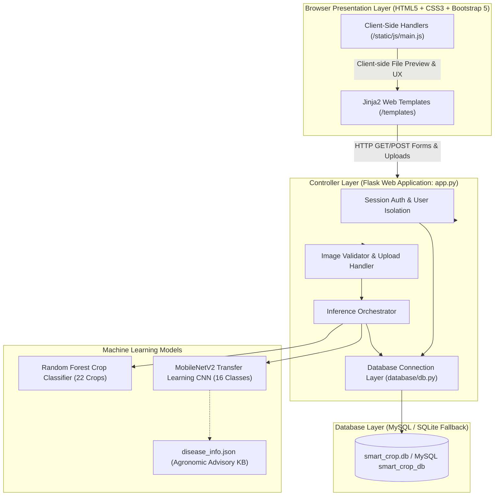

# System Architecture & Design

## 1. High-Level Architecture

The system follows a classic **Model-View-Controller (MVC) Web Architecture**:
1. **Presentation Tier (View - Jinja2 & Bootstrap 5)**: Responsive web templates providing user authentication pages, an interactive farmer dashboard, drag-and-drop leaf photo upload, soil parameter forms, and printable diagnosis reports.
2. **Application / Controller Tier (Controller - Python Flask)**: Flask routes in `app.py` handling session-based authentication, request validation, secure file upload storage, and orchestrating machine learning inference.
3. **Data & Model Tier (Model - Relational Database & ML Classifiers)**:
   - Relational tables (`users`, `disease_predictions`, `disease_recommendations`, `crop_recommendations`, `crop_information`) in MySQL with automatic SQLite fallback.
   - Serialized MobileNetV2 Deep Learning model (`models/disease_model.keras` / `.h5`) with 16 disease classes.
   - Serialized Random Forest Crop Recommendation model (`ml/crop_recommendation/model/crop_recommendation_rf.joblib`) with 22 crop classes.
   - Agronomic Knowledge Base (`database/disease_info.json`).

---

## 2. Component Breakdown

### 2.1 Presentation Tier (`/templates` & `/static`)
- **Base Layout (`base.html`)**: Global responsive navbar with active state indicators, flash message notifications, and user dropdown.
- **Predict Disease Page (`predict.html`)**: Dedicated leaf photo upload dropzone with client-side drag-and-drop handling and instant preview.
- **Diagnosis Report (`result.html`)**: Comprehensive diagnosis breakdown with confidence meter, structured symptoms, prevention, cure, chemical advice, and printable report format.
- **Crop Recommender (`crop_recommendation.html` & `crop_result.html`)**: Soil nutrient input form with fast demo presets and comprehensive cultivation guides.
- **Dashboard & History (`dashboard.html`, `history.html`, `crop_history.html`)**: Real-time diagnostic statistics and user-isolated logs.

### 2.2 Application Controller Tier (`app.py`)
- **Session-Based Authentication**: Secure session cookies using Werkzeug PBKDF2 password hashing.
- **File Upload Guard**: Validates MIME types, extensions (`.jpg`, `.jpeg`, `.png`), 16MB file size ceiling, and PIL image integrity.
- **Prediction Pipeline**:
  - Validates image integrity and scales dimensions to $224 \times 224 \times 3$.
  - Executes single-pass MobileNetV2 inference without duplicate preprocessing.
  - Checks against confidence threshold (60%) to prevent false diagnoses.
  - Queries `database/disease_info.json` for disease treatments.
- **Crop Recommendation Pipeline**:
  - Validates $N, P, K$, Temperature, Humidity, pH, and Rainfall within agricultural physiological limits.
  - Scales inputs using `StandardScaler` and runs Random Forest multi-class inference.
  - Returns recommended crop, top-3 candidates, and detailed cultivation guidelines.

### 2.3 Machine Learning Pipelines
- **Crop Disease Prediction**: MobileNetV2 pre-trained on ImageNet with fine-tuned top dense layers, trained on stratified PlantVillage dataset covering 16 classes across 7 crops (96.34% test accuracy).
- **Crop Recommendation**: Random Forest Classifier ($n=100$) trained on 2,200 agronomic samples covering 22 crops (98.86% test accuracy).
